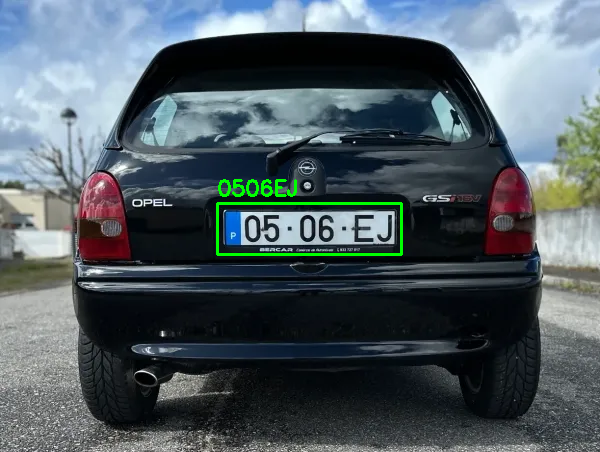
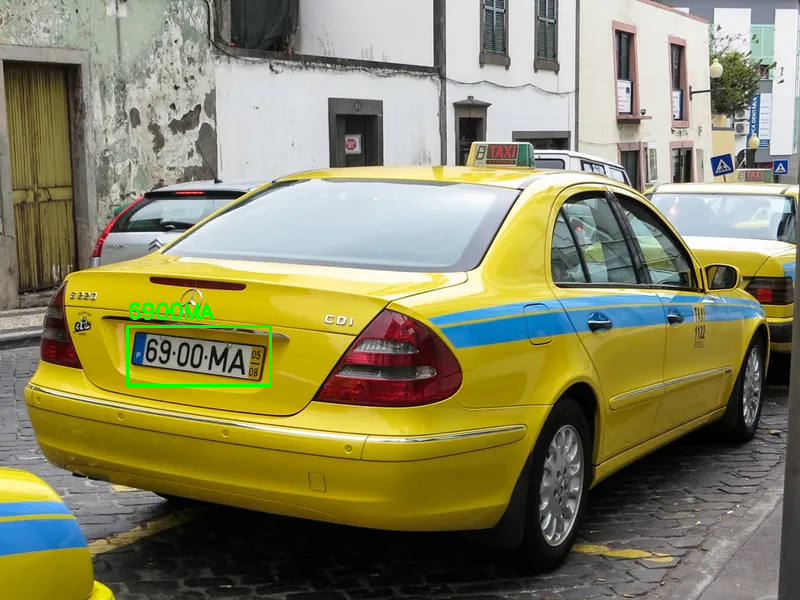

# Real-Time License Plate Recognition Using Smart Edge Devices for Surveillance

This repository contains the source code, evaluation tools, and sample datasets for the Master's Thesis: **Real-Time License Plate Recognition Using Smart Edge Devices for Surveillance**, developed at **Instituto Superior de Engenharia de Lisboa (ISEL)** by Sebastião Póvoa Ferreira.

## Overview
This project implements a lightweight, deep-learning-based Automatic License Plate Recognition (ALPR) pipeline optimized specifically for resource-constrained edge hardware. By distributing the computational workload across a heterogeneous System-on-Chip (SoC), the system achieves real-time, on-device inference without relying on cloud connectivity or heavy server-grade GPUs.


### Pipeline Demonstration

https://github.com/user-attachments/assets/928ab38b-9235-4f7e-93aa-de833ade606f

*(Sample test video sourced from Pexels).*

**Example Outputs:**
<p align="center">
  
  
</p>

## Hardware & Architecture
The system is designed for and evaluated on the **Khadas VIM3** single-board computer (Amlogic A311D SoC), leveraging both its ARM CPU cluster and its 5.0 TOPS Neural Processing Unit (NPU).

* **Detection Stage (YOLOv8n):** Accelerated on the Khadas VIM3 NPU using the KSNN API. The model was quantized to FP16 using the Khadas Acuity Toolkit.
* **Post-Processing (CPU):** Feature map decoding, confidence filtering (0.60), Non-Maximum Suppression (IoU 0.50), and Region of Interest (RoI) cropping.
* **Recognition Stage (PaddleOCR PP-OCRv4 Mobile):** Executed on the ARM Cortex-A73/A53 CPU cluster via ONNX Runtime. The graph was modified to replace unsupported `hard_swish` activations with Opset-11 compatible primitives.
* **Text Decoding (CPU):** Greedy CTC decoding with a 0-index blank token mapping, followed by regex-based syntactical filtering (`[^A-Z0-9]`).

---

## Datasets & Performance Metrics

### Datasets
* **Full Evaluation Dataset:** The full held-out test sets used for the thesis evaluation (800 detection images and 734 recognition crops) are too large to host directly in the source code. 
   **[Download the Full Dataset Here](https://drive.google.com/drive/folders/1edUpIwvIfuguPaMJYqGQvNhRRVkxyZCL?usp=sharing)**
* **Sample Data:** For quick testing, a small set of sample images and a test video are included in the `data/` directory.

## Installation

**1. Clone the repository:**
```bash
git clone [https://github.com/SebastiaoPFerreira/projeto_TFM_LPR_Edge.git](https://github.com/SebastiaoPFerreira/projeto_TFM_LPR_Edge.git)
cd projeto_TFM_LPR_Edge
```

**2. Install dependencies:**
Ensure you are running this on the Khadas VIM3 with the KSNN libraries installed natively. 
```bash
pip install -r requirements.txt
```

**3. Model Files:**
Ensure the compiled `.nb` and `.so` files for YOLOv8n, and the `.onnx` file for PaddleOCR are placed in the `models/` directory.

## Usage

The entire ALPR pipeline is consolidated into a single executable script: `pipeline.py`. It generates a detailed per-stage latency benchmark table upon completion.

**To run a batch evaluation on an entire dataset directory:**
```bash
python pipeline.py \
  --library models/libnn_yolov8n.so \
  --model models/yolov8n_fp16.nb \
  --ocr_onnx models/paddleocr.onnx \
  --folder data/sample_images/ \
  --output ./output_results
```

**To run the pipeline on a saved video file:**
```bash
python pipeline.py \
  --library models/libnn_yolov8n.so \
  --model models/yolov8n_fp16.nb \
  --ocr_onnx models/paddleocr.onnx \
  --source data/test_video/sample_traffic.mp4 \
  --output ./output_results
```

**To run a live USB Webcam (Camera 0):**
```bash
python pipeline.py \
  --library models/libnn_yolov8n.so \
  --model models/yolov8n_fp16.nb \
  --ocr_onnx models/paddleocr.onnx \
  --source 0 \
  --output ./output_results
```
*(Note: If you experience display issues on Wayland when running the live video feed, run `export QT_QPA_PLATFORM=xcb` before executing the script).*

## Citation
If you use this code, datasets, or methodology in your research, please refer to the thesis publication:

> Ferreira, Sebastião Póvoa. *Real-Time License Plate Recognition Using Smart Edge Devices for Surveillance.* Master's Thesis, Instituto Superior de Engenharia de Lisboa (ISEL), 2026.

## License & Acknowledgments
* Developed under the guidance of Dr. Mário Pereira Véstias.
* Published and presented at the YEF-ECE and INForum 2026 conferences.
* Royalty-free test video sourced from Pexels.
